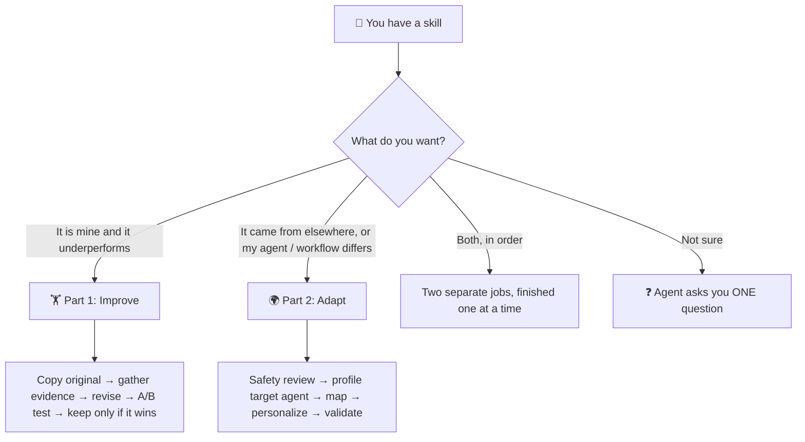
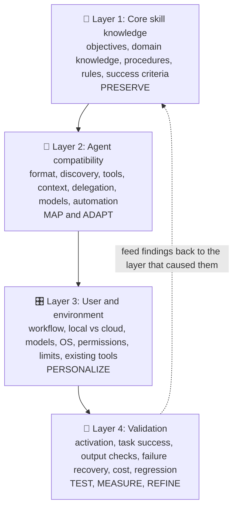

<div align="center">

# 🧠🔧 Skill Improver & Adapter

### *Because even your AI agent's skills deserve a growth arc.*


-orange)


**One skill. Two superpowers. Zero "it works on my machine."**

[What is this?](#-what-is-this) • [Humans vs. skills](#-humans-vs-skills-the-analogy-you-didnt-ask-for) • [Choose your path](#-choose-your-path) • [Use cases](#-use-cases) • [Quick start](#-quick-start) • [Limitations](#-limitations-the-honest-section) • [Pro tips](#-pro-tips) • [FAQ](#-faq)

</div>

---

## 🤔 What is this?

**Skill Improver & Adapter** is an [agent skill](https://www.anthropic.com/engineering/equipping-agents-for-the-real-world-with-agent-skills) (a `SKILL.md` folder of instructions, scripts, and references) that teaches your AI agent to do two very different jobs on *other skills*:

| | 🏋️ **Part 1: Improve** | 🌍 **Part 2: Adapt** |
|---|---|---|
| **You say** | *"I want you to improve my `<skill-name>` skill"* | *"I want you to adapt this `<skill-name>` skill according to my workflow"* |
| **Meaning** | Make a skill **you already have** work better, and *prove* it | Make a skill (often **downloaded** from GitHub or anywhere online) run on **your agent** and fit **your workflow** |
| **Core move** | Evidence → revise → A/B test → keep only if it wins | Safety review → profile the agent → map → personalize → validate |
| **Built from** | A skill-improvement procedure + the [SkillsBench paper](https://arxiv.org/abs/2602.12670) | A four-layer adaptation framework |

> 🔒 **The golden rule:** the two parts are **never mixed**. Ask to *improve* → only Part 1 runs. Ask to *adapt* → only Part 2 runs. Ask something ambiguous → your agent asks **one** question instead of guessing. (Yes, even AI agents benefit from not assuming. Humans, take notes.)

---

## 🧬 Humans vs. Skills: the analogy you didn't ask for

Turns out an agent skill has a lot in common with a person. Both can be **brilliant**, **stale**, **overconfident**, or **dropped into a new country with zero context.** This repo is basically *self-improvement + cultural integration*, for markdown files.

| 🧑 Human nature | 🤖 What this skill does about it |
|---|---|
| **"I feel like I'm getting better."** (the gym-selfie fallacy 📸) | Feelings aren't data. Part 1 makes you write **objective success checks *before* testing**, then measures original vs. revised. No vibes-based progress reports. |
| **Confirmation bias**: we find evidence for what we already believe | Every edit must trace to a real failure, a user correction, or a real task. *No evidence → no change.* |
| **Writing your own self-help plan at 3 a.m.** and finding it works worse than nothing | SkillsBench found skills that agents wrote for themselves scored **below having no skill at all** (about −8 to −11 points on all three setups tested). So this skill refuses to wing it. |
| **Placebo effect**: you tried the "new routine" and *of course* it worked | **Fresh session for every run**, same model, same harness, discovery confirmed. A blind taste test for instructions. |
| **Overkill**: using a flamethrower to light a candle 🔥 | The paper's "heavyweight pipeline" failure mode. Part 1 teaches **simplest valid method first**, with a lightweight fast path. |
| **Knowing when to quit** (the poker-night skill ♠️) | **Fallbacks and stop conditions** are first-class citizens. The agent knows when to try plan B and when to say "I need a human." |
| **Moving abroad**: same *you*, different customs, plugs, and etiquette 🔌 | **Part 2.** Your core knowledge stays; the *operations* change to fit the new environment (a travel adapter, not a personality transplant). |
| **Code-switching**: you at work ≠ you at a LAN party ≠ you at Grandma's | One skill, many agents. Core logic stays, agent-specific tools get **mapped**, your preferences live in a separate **config layer**. |
| **Stranger danger** 🍬 | Downloaded skills are **untrusted**. Part 2 does a read-only safety scan *before anything runs*. Don't accept installers from strangers. |
| **"Trust me, bro."** | Nothing is "done" until there's evidence. Reports say what was tested **and what wasn't.** |
| **Save-scumming before the boss fight** 💾 | The original is **always copied first** and never edited in place. |

---

## 🗺️ Choose your path



<details>
<summary><b>🎮 Click to find your class (a very scientific quiz)</b></summary>

- ✅ *"I wrote/own this skill and it keeps flopping."* → **🏋️ The Grinder** → Part 1
- ✅ *"It never triggers when I need it."* → **🏋️ The Grinder** → Part 1 (description fix)
- ✅ *"I found a cool skill on GitHub, but I use a different agent."* → **🌍 The Traveler** → Part 2
- ✅ *"I'm on Windows + local models + I like my outputs in a specific folder."* → **🌍 The Traveler** → Part 2
- ✅ *"This skill came from a stranger on the internet and I'm nervous."* → **🌍 The Traveler** → Part 2 (safety review comes first)
- ✅ *"Make it better for me."* → **🤷 The Ambiguous** → your agent will ask which one you mean

</details>

Copy-paste prompts:

```text
I want you to improve my <skill-name> skill.
```

```text
I want you to adapt this <skill-name> skill according to my workflow.
```

---

## 🏋️ Part 1: Improve (the Growth Mindset Arc)

> *"The unexamined skill is not worth installing."* — Socrates, probably

The agent follows an evidence-first loop:

1. 📸 **Snapshot**: copy the original (never overwrite it). Record model + harness so both versions face identical conditions.
2. 🔎 **Inspect**: run the static audit (`scripts/audit_skill.py`), then actually read the whole skill.
3. 🧾 **Gather evidence**: past failures, repeated corrections, real tasks. Build a test set with **objective success checks written first**, including a "should *not* trigger" prompt.
4. 🩺 **Diagnose**: map each symptom to a cause (vague description, heavyweight pipeline, no fallback, wrong "gotcha", missing output-format detail…).
5. ✍️ **Revise** with these principles:
   - clear task-selection rules
   - short, ordered procedures
   - prerequisites and constraints up front
   - simplest valid method first
   - fallback steps and stop conditions
   - objective success checks
   - no unrelated instructions, no task-specific answers
6. 🧪 **Test** original vs. revised: same tasks, same model, same harness, **fresh session each run**, skill-use confirmed. Records success, errors, time, unnecessary tool calls, and context use.
7. ⚖️ **Decide**: keep the revision *only* when the data justifies it.
8. 📝 **Report**: results, failures, **remaining risks.**

### The verdict cheat sheet

`scripts/compare_runs.py` gives a *suggested* verdict (it's a heuristic, not a statistician):

| Verdict | What it means | Human equivalent |
|---|---|---|
| ✅ **KEEP REVISION** | Clear gain, no regressions (or equal success at clearly lower cost) | "I actually changed, and I have receipts." |
| 🔙 **KEEP ORIGINAL** | Revision made things worse | "I tried the new diet. It was a mistake." |
| 🤨 **MIXED** | Gains, but some tasks regressed | "Better at coding, forgot how to cook." |
| 🌫️ **INCONCLUSIVE** | Differences are within noise | "Did the vitamins work? Who knows." (Add data.) |

It also prints a **confidence** line (it says *low* if there are fewer than 5 tasks, fewer than 3 trials in a cell, or no skill-use data), so a fluke can't pose as a breakthrough.

---

## 🌍 Part 2: Adapt (the Expat Arc)

> *"Same developer, different keyboard layout."*

The core idea: **separate what a skill *knows* from how an agent *executes* it and how *you* need it to work.**



| Layer | Human version | Example |
|---|---|---|
| 🧠 **1. Core knowledge** | Your values and skills; they travel with you | "Run tests, summarize failures, never skip the lint step" |
| 🔌 **2. Agent compatibility** | Local language, plugs, and customs | "This agent has no subagents → run sequentially and note the loss" |
| 🎛️ **3. User/environment** | Your own habits and house rules | "Windows, local models, save reviews to `REVIEWS/`, ask before writing files" |
| 🧪 **4. Validation** | Checking the locals actually understood you | Fresh-session activation check + a real task with a success check |

The five steps: **inspect the source skill → identify the target agent → separate portable logic from agent dependencies → apply your workflow → test and refine.**

> 🛡️ **Step 0 is a bouncer.** Before anything is adapted, run, or installed, the agent keeps an untouched source copy, runs a **read-only** scan (`scripts/inventory_skill.py`) for things like pipe-to-shell installers, credential access, hidden characters, and "ignore previous instructions" text, and reads every script. Suspicious? It **stops and shows you the exact lines.**

---

## 🎯 Use cases

<details open>
<summary><b>🏋️ 1. "My skill keeps failing the same way."</b></summary>

You keep correcting the same mistake (wrong date format, forgotten edge case, output in the wrong shape). Part 1 turns your corrections into **test cases with objective checks**, fixes the cause, and verifies the fix didn't break what already worked.

</details>

<details>
<summary><b>🏋️ 2. "My skill never triggers."</b></summary>

The agent has the skill and never opens it. Part 1 treats the `description` as the trigger surface: rewrite it with real user phrases and scope limits, then confirm discovery in a **fresh session** (including a "should *not* trigger" check so it doesn't over-fire).

</details>

<details>
<summary><b>🏋️ 3. "My skill is slow, bloated, and burns tokens."</b></summary>

Part 1 compares tool calls, wall-clock time, unnecessary calls, and context use between versions. Heavy recipes get a simplest-first path, long material moves into `references/`, and mechanical work becomes a script.

</details>

<details>
<summary><b>🌍 4. "I found a great skill on GitHub, but I use a different agent."</b></summary>

Port it to Codex, Claude Code, Hermes, OpenCode, Gemini CLI, OpenHands, or whatever you run. The agent profiles **your actual agent** (verified in your environment, not recalled from memory), maps tool names, paths, and delegation, and builds fallbacks where capabilities are missing.

</details>

<details>
<summary><b>🌍 5. "Cloud skill, local setup."</b></summary>

The skill assumes a hosted model and a Unix shell; you run local models on Windows. Part 2 swaps shell commands and paths, removes hard-coded model names, offers local alternatives for cloud calls, and records every assumption that changed.

</details>

<details>
<summary><b>🌍 6. "Make a shared skill fit my team's / my own house rules."</b></summary>

Output locations, naming, approval gates, verbosity, language: all go into a **separate configuration layer**, so you can change your preferences without touching the core method.

</details>

<details>
<summary><b>🌍 7. "Is this random skill safe to install?"</b></summary>

Even if you never finish the adaptation, Step 0 gives you a structured security review of a downloaded skill: scripts read, risky patterns listed with file and line, and a clear stop/continue decision.

</details>

---

## 🚀 Quick start

**1. Get the skill**

```bash
git clone https://github.com/<your-username>/skill-improver-and-adapter.git
```

**2. Install it where your agent looks for skills**

- If your platform shows a **Save skill** button on the packaged `.skill` file, use that.
- Otherwise, copy the `skill-improver-and-adapter/` folder into your agent's skills location (check your agent's docs; locations differ and change over time).
- 🪄 *Meta trick:* your agent doesn't support this format directly? Ask it: **"adapt this skill according to my workflow"** and point it at this folder. The skill can port itself. Very ouroboros.

**3. Talk to your agent**

```text
I want you to improve my <skill-name> skill.
```

```text
I want you to adapt this <skill-name> skill according to my workflow.
```

**4. (Optional) Run the helper scripts yourself**

Python 3, standard library only (tested on 3.12; PyYAML is used if present, but not required).

```bash
# Part 1 helpers
python scripts/audit_skill.py path/to/your-skill            # static audit
python scripts/compare_runs.py runs.csv \
    --original original --revised revised                    # paired comparison

# Part 2 helper (read-only, executes nothing from the skill)
python scripts/inventory_skill.py path/to/downloaded-skill  # dependencies + security review
```

`assets/runs_template.csv` has the columns for your test runs.

---

## 📦 What's in the box

```text
skill-improver-and-adapter/
├── SKILL.md                      # routing rules + shared principles (read first)
├── references/
│   ├── improve-workflow.md       # Part 1: the full improve procedure
│   └── adapt-workflow.md         # Part 2: the full adapt procedure
├── scripts/
│   ├── audit_skill.py            # Part 1: static audit of a skill folder
│   ├── compare_runs.py           # Part 1: original vs revised, paired results + verdict
│   └── inventory_skill.py        # Part 2: dependency inventory + security scan (read-only)
├── assets/
│   ├── improvement-report.md     # Part 1 report template
│   ├── runs_template.csv         # Part 1 run-log columns
│   ├── target-agent-profile.md   # Part 2 target-agent profile template
│   └── adaptation-notes.md       # Part 2 adaptation notes template
└── evals/
    └── evals.json                # routing and behavior test prompts
```

---

## ⚠️ Limitations (the honest section)

A skill that preaches evidence should disclose its own. 🫡

- 🧪 **Project status:** the helper scripts were tested on real skills and on synthetic ones (including deliberately bad ones). The routing and workflows have **not yet been validated end-to-end with independent agent runs** by the author. `evals/evals.json` holds five prompts for exactly that. **Real-world run reports are very welcome.** <!-- Update this bullet as you gather results. -->
- 📏 **Thresholds are heuristics.** "Keep if +0.10 success", "≥5 tasks", "regression = drop of 0.34+" are sensible defaults, **not** statistics and not from the paper. Tune them, and treat low-confidence verdicts as "promising", not "proven".
- 💸 **Testing costs real runs.** Tasks × trials × versions adds up (3 trials per task is the default, following the paper). Fewer runs means lower confidence; the report says so.
- 🧼 **Fresh sessions are required for honest results.** If your agent offers no subagents, headless mode, or way to start clean sessions, results are contaminated and must be labeled as weak. The skill says so rather than pretending.
- 🎭 **Objective checks need objective tasks.** Fuzzy outputs (tone, style, taste) need a rubric *you* write first, ideally judged blind to which version produced the output.
- 🔬 **The research has boundaries.** SkillsBench covers 87 containerized terminal tasks with deterministic verifiers, using well-made skills. Results may not carry over to GUI agents, multi-agent setups, or very long workflows, and its "shorter skills do better" findings are **correlational**; they tell you to be suspicious of bloat, not that trimming always helps. **Test the cut.**
- 🔁 **Different stacks benefit differently.** The paper's gains ranged from +4.1 to +25.7 points depending on the model/harness combo. Your agent is not the average agent.
- 🔌 **No baked-in agent facts.** The skill deliberately doesn't hard-code what each agent supports (they change fast). It verifies in *your* environment, which is correct but means a little more work up front.
- 🛡️ **The security scan is a heuristic.** A clean result isn't a guarantee of safety, and a hit isn't proof of malice. It supports human judgment; it does not replace it.
- 📜 **Licenses matter.** Adapting a downloaded skill may be restricted by its license. The skill flags missing licenses; it can't resolve legal questions.
- 🧭 **Adapt ≠ improve.** Part 2 *preserves* the skill's method and fixes only clear defects. If you want a deeper quality overhaul, that's a separate Part 1 request.
- 🪫 **It can't polish a fundamentally bad idea.** A skill built on wrong assumptions needs rethinking, not edits. And no skill can make an underpowered model suddenly brilliant (though the paper found skills can help smaller models close some of the gap).

---

## 💡 Pro tips

Get the *most* out of it:

- [ ] **Bring receipts.** Transcripts of failures, the corrections you keep repeating, and real prompts beat any description of the problem.
- [ ] **Write success checks before you test**, not after you see the output. (Humans call this "not moving the goalposts.")
- [ ] **Don't name the skill in your test prompts.** Real use depends on the agent *finding* it.
- [ ] **Include a "worked before" task** as a regression guard and a **"should not trigger" prompt** as a scope guard.
- [ ] **Change a little, test, repeat.** One giant rewrite makes it impossible to know what helped.
- [ ] **Include a no-skill arm** if you suspect the skill might be hurting. (13 of 87 SkillsBench tasks got *worse* with skills.)
- [ ] **Re-test after model or agent upgrades.** A skill that fit last quarter's model may be dead weight now.
- [ ] **Keep your preferences in the config layer** (Part 2) so upgrades to the core skill don't erase *you*.
- [ ] **Review scripts before approving them**, especially ones that install things or use the network.
- [ ] **Share your results.** Open an issue or PR with your run report and help build the evidence base. 🌱

---

## ❓ FAQ

<details>
<summary><b>Will it edit my original skill?</b></summary>

No. Both parts copy the original first and work on a copy. Installing anything into your live skills folder needs your go-ahead.

</details>

<details>
<summary><b>What if I say something ambiguous, like "fix this skill"?</b></summary>

Your agent asks **one** question: *improve quality (Part 1) or adapt to your agent and workflow (Part 2)?* It won't guess, and it won't do both.

</details>

<details>
<summary><b>Can I ask for both?</b></summary>

Yes. They run as **two separate jobs** in the order you name, with the first fully reported before the second starts. The procedures are never blended.

</details>

<details>
<summary><b>Does it work with agents other than Claude?</b></summary>

That's literally Part 2's job. The skill itself is a standard `SKILL.md` package with plain-text references and stdlib-only Python scripts; for agents with a different format, ask your agent to adapt it.

</details>

<details>
<summary><b>Why so much emphasis on testing?</b></summary>

Because in the research behind this skill, skills helped on average, but not always, and not equally. Some made results *worse*, and agent-written skills did worse than no skill. "It looks better" isn't evidence; a paired test is.

</details>

---

## 🙏 Credits & research

- **Part 1** follows a skill-improvement procedure (inspect → gather evidence → revise → test both versions → keep only if justified) and draws guidance from:
  **SkillsBench: Benchmarking How Well Agent Skills Work Across Diverse Tasks**, Li et al., arXiv [2602.12670](https://arxiv.org/abs/2602.12670) (v4). Numbers quoted in this repo (e.g., +16.6 points average gain, 13 of 87 tasks negative, self-generated skills −8 to −11 points) come from that paper and apply to its benchmark conditions.
- **Part 2** follows a four-layer adaptation framework (core knowledge, agent compatibility, user/environment adaptation, validation) and its five-step application process.
- The Agent Skills format is described by Anthropic in [Equipping agents for the real world with Agent Skills](https://www.anthropic.com/engineering/equipping-agents-for-the-real-world-with-agent-skills).

---

## 🤝 Contributing

Found a failure mode? Got run results from your agent? Wrote a smarter heuristic? PRs and issues welcome. Especially:

- 🧪 end-to-end run reports (agent, model, tasks, verdict)
- 🔌 verified notes on how specific agents discover and load skills
- 🛡️ new patterns for the security scan (with false-positive notes)

## 📄 License

*Add your license here (and check the licenses of anything you adapt with it).*

---

<div align="center">

**Be the skill that improves with evidence and adapts without losing itself.** 🧬

*(Humans: you're welcome to try this approach too.)*

</div>
